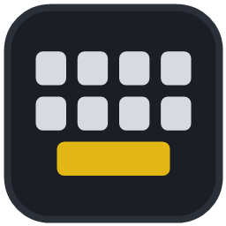
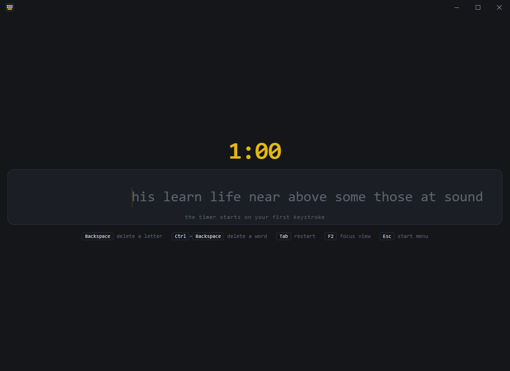
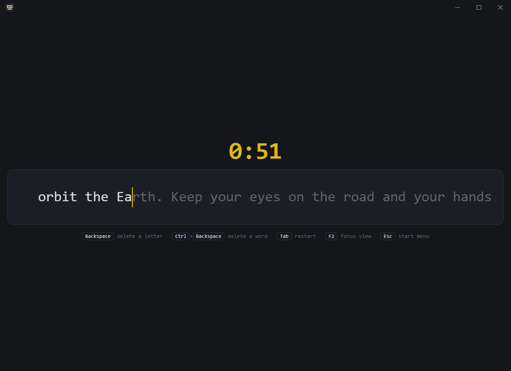
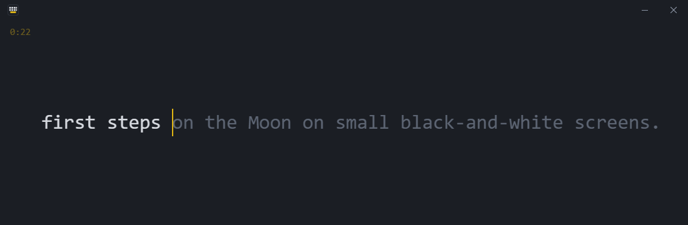
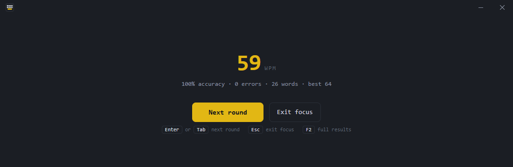
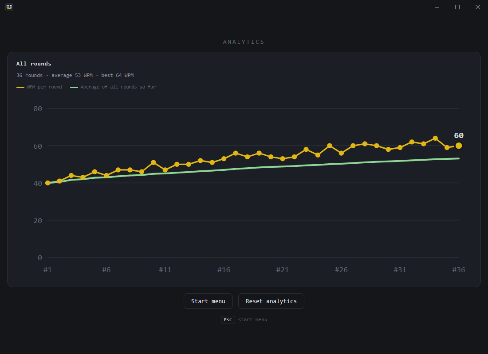
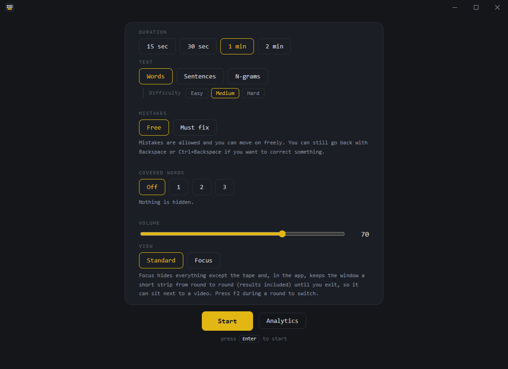
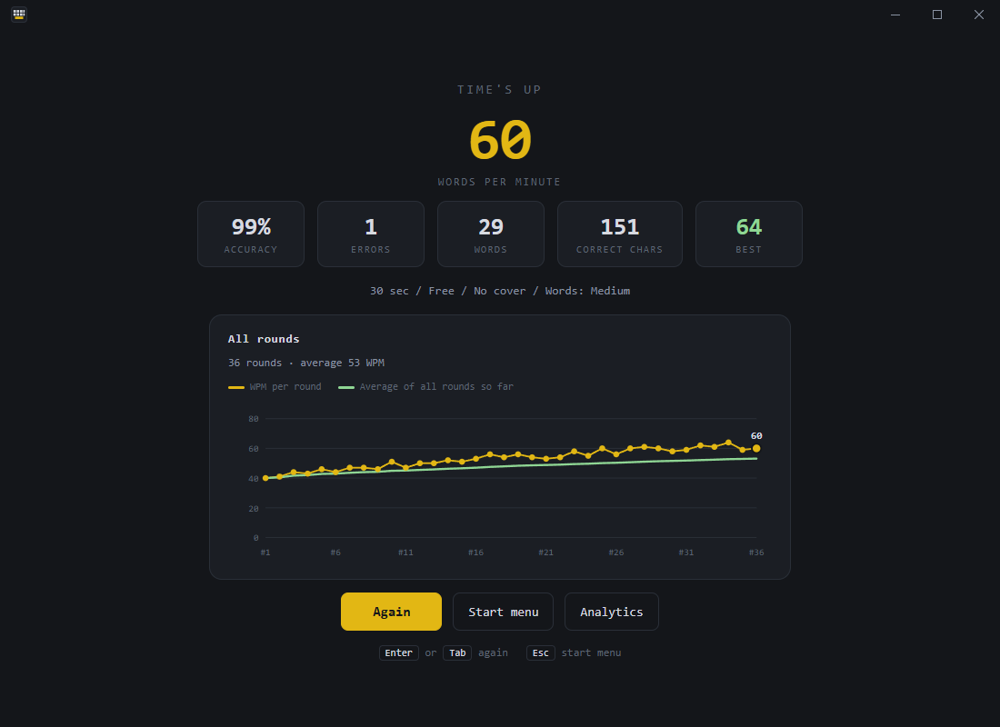

  

<h1 align="center">Typing Tape</h1>

  A simple typing practice app for Windows.

  <a href="https://github.com/MartinMans/typing-tape-public/releases/latest"><b>Download for Windows</b></a>
  &nbsp;·&nbsp;
  <a href="docs/INSTALLATION.md">Installation</a>
  &nbsp;·&nbsp;
  <a href="CHANGELOG.md">Changelog</a>
  &nbsp;·&nbsp;
  <a href="docs/PRIVACY.md">Privacy</a>

Typing Tape is a typing practice app I originally built for myself.

I wanted a simple way to improve my typing speed, so I made something I could practice with
regularly and use to track my progress. The idea is one endless tape of text that scrolls past a
caret that stays in place, so your eyes never have to jump to a new line. You just keep typing.

After spending time refining it, I figured it might be useful to other people too, so I decided
to share it. It is free, it works offline, and everything it saves stays on your PC.

## Screenshots

| Ready to type | Typing |
| --- | --- |
|  |  |

| Focus view | Analytics |
| --- | --- |
|   |  |

More screenshots: the start menu and the results screen

 

| Start menu | Results |
| --- | --- |
|  |  |

The screenshots are of the real app, filled with a set of sample rounds.

## Features

- **An endless tape.** Text scrolls one character at a time past a fixed caret. The text size
  follows the window size.
- **Timed rounds** of 15 seconds, 30 seconds, 1 minute or 2 minutes. The clock starts on your
  first keystroke, and only the countdown is shown while you type.
- **Three kinds of text**
  - Words, in Easy, Medium or Hard.
  - Sentences: 448 original sentences with capitals and punctuation, picked so that recent
    ones do not come back soon.
  - N-grams: the most common 2, 3 and 4 letter sequences, for drilling letter combinations.
- **Two mistake modes.** *Free* lets you carry on past errors; *Must fix* will not let you
  leave a word until it is typed correctly.
- **Covered words.** Hide the next 1 to 3 words until you type them, to train reading ahead.
- **Focus view.** Shrinks the window to a slim strip that can sit beside a video or a document,
  and keeps you there from round to round.
- **Results and analytics.** Words per minute, accuracy, errors, words and best score after every
  round, and a chart of all your rounds with a running average.
- **Synthesized key sounds** with a volume control; set it to 0 for silence.

## Download and install

Typing Tape runs on **Windows 11 (64-bit)**. Windows 10 (64-bit) is expected to work but has
not been tested. It uses the Microsoft Edge WebView2 Runtime, which is already part of
Windows 11.

Get it from the [latest release](https://github.com/MartinMans/typing-tape-public/releases/latest).
There are two versions:

| Download | What it is |
| --- | --- |
| **Installer** (`Typing-Tape_<version>_x64-setup.exe`) | Recommended. Installs for your user account only, without administrator rights, and adds a Start Menu entry and an uninstaller. |
| **Portable** (`Typing-Tape_<version>_x64-portable.zip`) | Unzip anywhere and run `Typing Tape.exe`; nothing is installed. Your history and settings are still saved in your Windows profile, not next to the exe. |

> **The downloads are not code-signed.** Windows SmartScreen may show "Windows protected your
> PC" (choose *More info*, then *Run anyway*), and on PCs with Smart App Control turned on the
> app may be blocked. You can check that a download is genuine with the checksums in
> `SHA256SUMS.txt`, attached to each release.

Step-by-step instructions, checksum verification, updating and uninstalling are in
[docs/INSTALLATION.md](docs/INSTALLATION.md).

Typing Tape does not update itself. New versions are published on the
[Releases page](https://github.com/MartinMans/typing-tape-public/releases).

## Keyboard shortcuts

| Where | Key | Action |
| --- | --- | --- |
| Start menu | <kbd>Enter</kbd> | Start a round |
| During a round | <kbd>Backspace</kbd> | Delete a letter |
| | <kbd>Ctrl</kbd>+<kbd>Backspace</kbd> | Delete a word |
| | <kbd>Tab</kbd> | Restart the round |
| | <kbd>F2</kbd> | Switch between Focus and Standard view |
| | <kbd>Esc</kbd> | Back to the start menu |
| After a round | <kbd>Enter</kbd> or <kbd>Tab</kbd> | Next round |
| | <kbd>Esc</kbd> | Back to the start menu |
| | <kbd>F2</kbd> | In Focus view: leave Focus and show the full results |
| Analytics | <kbd>Esc</kbd> | Back to the start menu |

## Your data and privacy

Typing Tape keeps your round history and a few settings on your own PC, in
`%LOCALAPPDATA%\com.martin.typingtape`. It has no accounts, no cloud sync, no analytics and no
telemetry, and it works fully offline. Uninstalling keeps your data unless you tick the option
to delete it. Details: [docs/PRIVACY.md](docs/PRIVACY.md).

## License

Typing Tape is **freeware**: free of charge, but not open source. In short:

- Free to download and use, for personal or commercial purposes.
- Free to copy and share with others, if the software is unmodified and you share it free of
  charge.
- Not to be sold or distributed for a fee, including as part of a paid bundle.
- Not to be passed off as your own work; copyright notices must stay.
- No modified versions may be distributed without permission.
- The source code is proprietary and is not included.
- Provided as is, without warranty.

The full terms are in [LICENSE.txt](LICENSE.txt), which is also installed with the app and
included in the portable ZIP. Typing Tape includes open-source components under their own
licenses, listed in [THIRD-PARTY-NOTICES.txt](THIRD-PARTY-NOTICES.txt). This repository contains
the documentation and releases only; the source code is not published.

## Documentation

- [Installation](docs/INSTALLATION.md): downloads, warnings, checksums, updating and uninstalling.
- [Privacy](docs/PRIVACY.md): what is saved, where, and how to delete it.
- [Changelog](CHANGELOG.md), and the [1.0.0 release notes](RELEASE_NOTES_1.0.0.md) with checksums.

## Feedback

If you find a bug or have an idea, I would like to hear about it.
[Open an issue](https://github.com/MartinMans/typing-tape-public/issues/new/choose) and include:

- the Typing Tape version (shown in *Settings > Apps > Installed apps*, or in the name of the
  file you downloaded),
- your Windows version, and whether you use the installer or the portable version,
- what you did, what you expected and what happened instead; a screenshot helps.

Please check existing issues first, and do not post personal information: issues are public.
